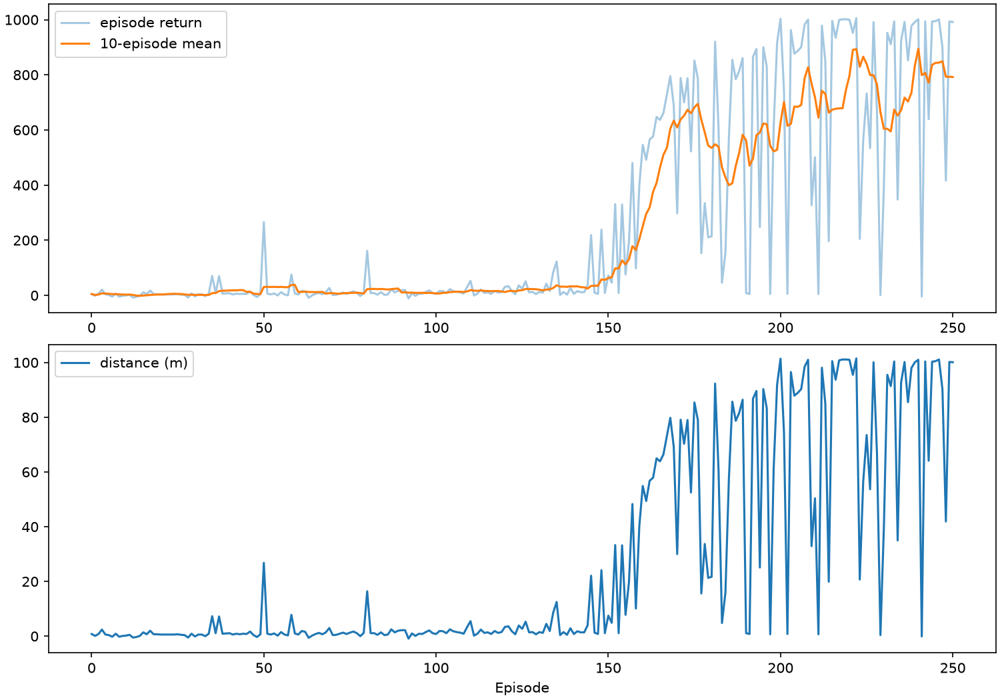
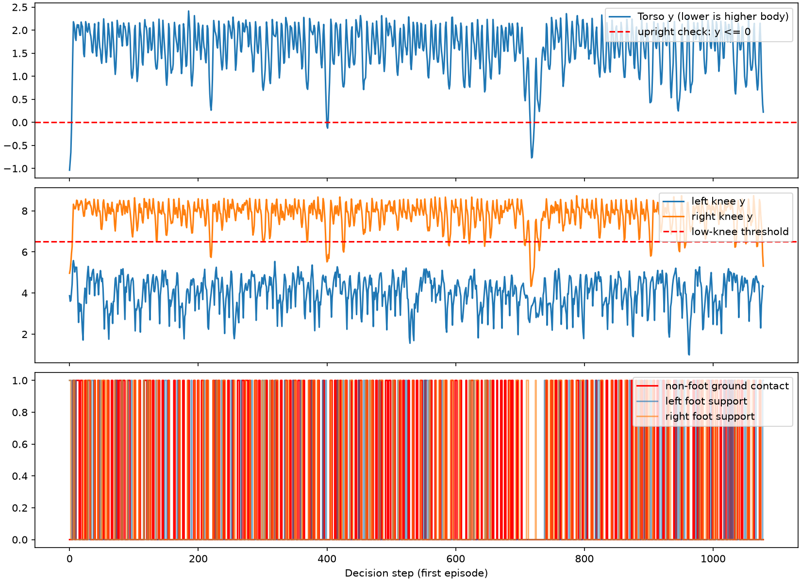
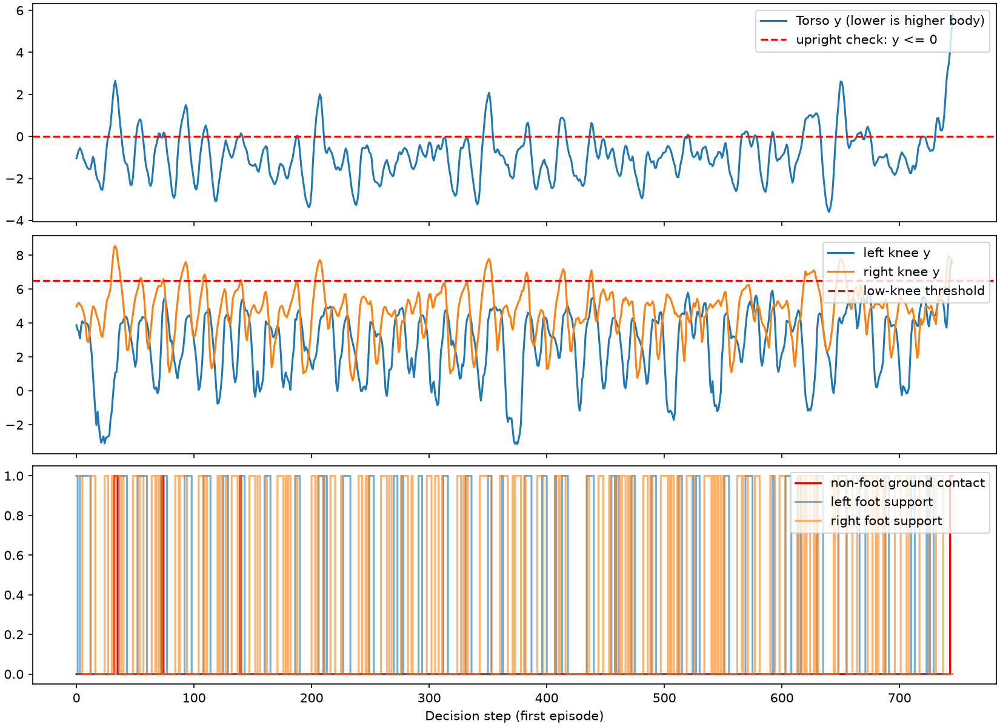
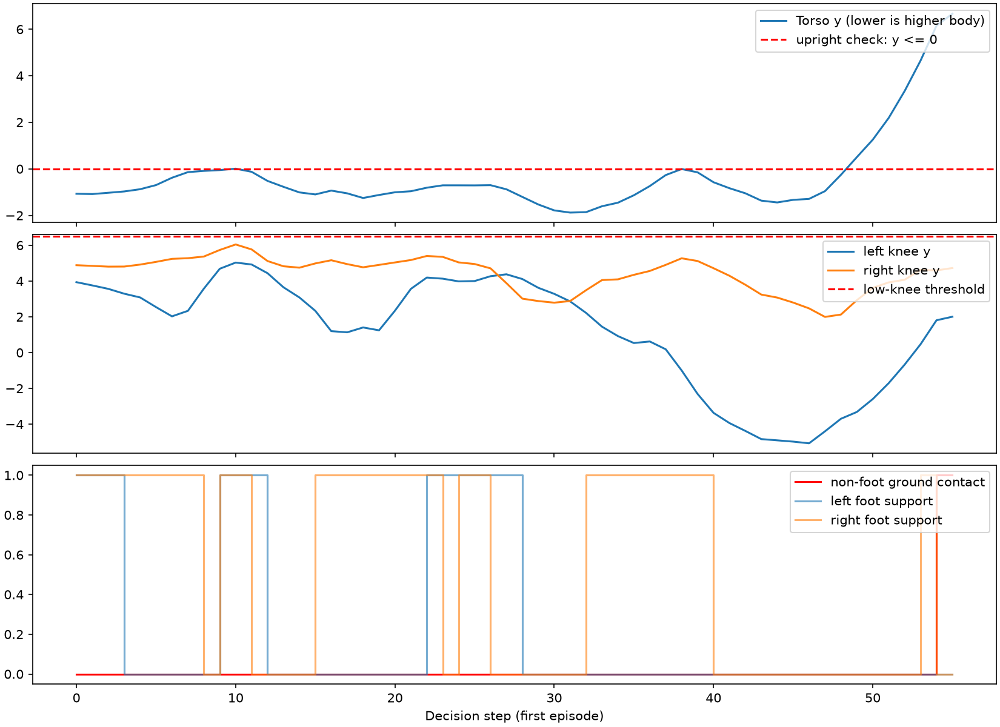
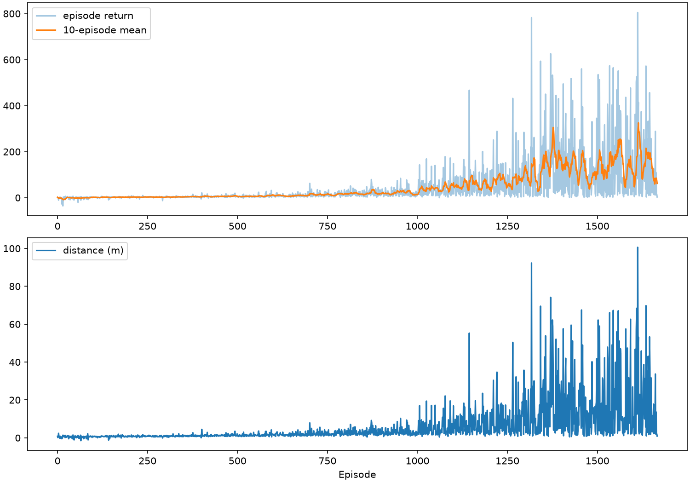
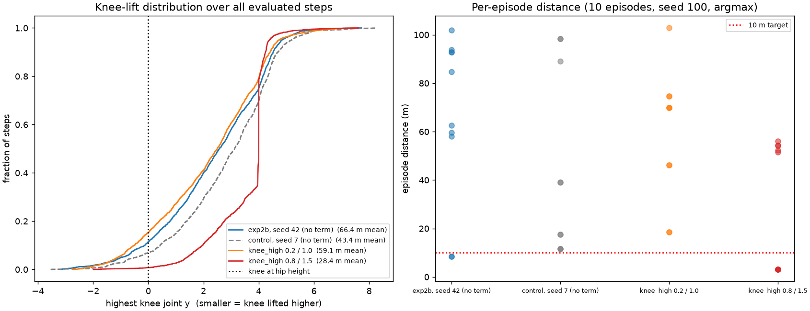

# QWOP 强化学习实验报告

姓名/小组：lihanwen（单人）
实验日期：2026-10-31 训练与录像；2026-11-11 补同预算基线与采样对照；2026-11-19 撰写报告，并追加抬膝惩罚实验

---

## 0 摘要（先看这段）

这份作业只问一件事：奖励函数怎么改，才能把"跪着滑到 100 米"变成"站着走到终点"。

一共训练 10 次（其中 1 次是 2048 步的流程检查，不算结论），9 次用来下判断，可以分成三段（明细对账：4.1 主表 8 行，加 4.5 里的种子对照 1 次，再加流程检查 1 次，正好 10 次；`experiment_log.csv` 也是 10 行）：

- **前两轮（纯位移，32k / 131k）**：只给前进奖励时，训练量一够，它就用跪姿滑满全程（106.24 m，直着身子只有 0.5% 的时间）。
- **中间四轮（门控 0.6、膝部惩罚 0.1 / 0.5、门控 0.9）**：给低姿态打折没用；真正让它站起来的是"膝盖贴地"惩罚（门控 0.6 + 膝 0.1，距离 66.36 m、直着身子 79%），代价是距离比基线掉 40 米、偶尔摔；再加码就变成罚住前进（44.31 m）或者干脆不走（34.57 m）。
- **最后三轮（抬膝惩罚 0.2 / 0.8、换种子对照）**：想顺手修掉"高抬腿"，权重 0.2 没效果、0.8 把步态换成了"蹲着挪"（28.40 m）；同时量出同一配置换个随机种子，距离就差 35%，所以前面的单种子结论只能当趋势看。

一句话结论：**奖励设计直接决定行为类型**——同样的网络、同样的预算，只改奖励里的几个权重，就能得到"跪行""直立但易摔""站着不动""蹲着挪"四种完全不同的东西。任务书要求的三问、每条假设的检验和全部数据位置在正文里。

---

## 1 目标与假设

目标：训练一个用 Q/W/O/P 控制 QWOP 的策略，让它把距离走出来，同时尽量保持直立姿态；并且解释它为什么会变成这个样子，而不只是看最后跑了多少米。

主实验动手前先把假设写下来，事后不回头改：

- **H1（纯位移奖励会奖励跪行）**：只奖励每步前进距离时，跪行重心低、不容易摔倒，能连续走完全程拿满奖励；直立每步位移更大，但重心高、更容易摔倒，一次摔倒就丢掉剩下的所有奖励。预测：纯位移训练越久，跪行越明显。
- **H2（只加高度门控不够）**：高度门控只是给低姿态时的前进奖励打折，跪行即使只剩四成也还能稳定拿满全程，直立仍然会摔。预测：只加门控，距离可能到 100 m，但姿态依然很低。
- **H3（膝部惩罚能立起来，但有代价）**：膝盖贴近地面是有代价的物理动作，给膝部过低加惩罚会逼策略抬膝，但抬膝后步态更难维持，距离会掉。预测：`upright` 明显上升，距离低于纯位移。
- **H4（惩罚过头的两种坏结局）**：膝部惩罚加太大会压住前进（距离暴跌但还在走）；门控加太大会让策略发现"站着不动"比"走着挨罚"更划算，于是干脆不走。预测：前者短回合变多，后者出现低距离、高 `upright`、`knee_low=0` 的回合。

2026-11-19 又追加了一条，是看完 exp2b 的录像、发现它像高抬腿行军之后才提出的，写在 4.5 里，不算在最初的 H1~H4 之内：

- **H5（抬膝过高可以单独惩罚）**：原奖励只罚膝盖过低，没有上限；给膝盖设一个高度上限、罚超过阈值的部分，应该能让抬腿低一点而不明显损失距离。预测：抬膝分布下移、距离小幅下降。

事后看，H1 的表述需要修正（见 4.2），H2~H4 基本成立；H5 只在很重的权重下成立，而且代价是把走法整个换掉（见 4.5）。

---

## 2 代码来源与训练设置

采用**路线 A**：课堂提供的 `starter/`（Gymnasium + Stable-Baselines3 PPO + PyTorch + 浏览器里的原游戏）。仓库：`github.com/RobotIC-2027-Algorithm-Intern/Assignment-3-Reinforcement-Learning`，本次使用的代码提交为 **`a937568`**（starter 原始提交 `bd8bac4`）。全部模型**从零训练**，没有使用预训练模型、老师参考策略或上游旧模型。starter 的适配工作属于课程提供方（见 `starter/ADAPTATION.md`），我只改动了训练脚本的几个开关，并在 11-19 的追加实验里改了一处奖励公式，见第 3 节。

各实验的代码版本记在 `experiment_log.csv` 的 `code_version` 列：主实验都是 `a937568`，11-19 的追加实验（exp5 / exp5b / 种子对照）是 **`ff215e2`**（在 `a937568` 之上新增 `knee_high` 项）。主体代码没有变，所以两者可以直接比较。

| 项 | 设置 |
| --- | --- |
| 系统 / 浏览器 | Ubuntu 22.04.5 LTS，Intel Core Ultra 7 255HX；Google Chrome 155.0.8059.84，headless + direct-CDP |
| Python 环境 | Conda `torch`（**与任务书建议的 `qwop-rl` / Python 3.12 不同**）：Python 3.11.17，torch 2.14.1+cu130，stable-baselines3 2.7.1，gymnasium 1.2.3，selenium 4.52.0，pandas 3.1.0，numpy 2.4.6，tensorboard 2.21.0；完整清单见 `train_logs/<实验>/packages.txt` |
| 计算设备 | CPU（`--device cpu`）。本机 `torch.cuda.is_available()` 为 False（NVIDIA 驱动不可用），因此**没有做 GPU 训练** |
| 算法 | PPO，MlpPolicy，策略/价值网络各两层 128 单元；n_steps 1024，batch_size 64，n_epochs 10，lr 3e-4，γ 0.995，ent_coef 0.02，seed 42（只有种子对照那次是 seed 7） |
| 观测 / 动作 | 未修改：游戏身体状态数值向量；11 个按键组合（`qw,qo,qp,q,wo,wp,w,op,o,p,无`） |
| 标准化 | VecNormalize（观测 + 奖励），与模型一起保存为 `normalize.pkl` |
| 每动作游戏更新 | 3 次（`frame_skip=3`，约 0.05 秒/动作），`--fast` 固定物理步长，不按真实时间 |
| 回合上限 | 训练 1500 动作/回合；评估 3000 动作/回合（另有游戏内 120 秒计时截断） |
| 实际采样步数 | 正式实验每次 **131072**（训练日志 `total_timesteps: 131072`，128 次迭代）；131k 实验每趟 188~200 秒（基线实验日志记录 195 秒 / 669 fps）；起步基线 32768（63 秒）；流程检查 2048（6 秒） |
| 评估条件 | 10 回合、seed 100、起始等待 0~3 步、确定性策略（取 argmax）、headless + direct-cdp；**所有实验完全一致** |

训练/评估/录像都通过 `course.py` 调用，以主片实验为例（完整命令见附录 A）：

```bash
python course.py train --out runs/exp2b-gate-knee01-1031-110114 --steps 131072 --seed 42 --reward configs/exp2b_gate_knee01.json
python course.py evaluate --run runs/exp2b-gate-knee01-1031-110114 --out runs/exp2b-gate-knee01-1031-110114-eval
python course.py record --run runs/exp2b-gate-knee01-1031-110114 --out videos/exp2b-gate-knee01-1031-110114
```

📌 **需要说明的环境差异**：任务书建议 Python 3.12 + torch 2.7.1 的 `qwop-rl` 环境；这台机器实际能跑通的是 Python 3.11 + torch 2.14.1 的 `torch` 环境，且没有可用 CUDA。这个差异只在依赖层面，代码和物理更新步长没有变。

---

## 3 修改清单

主实验（10-31 与 11-11 那几轮）只改了训练脚本的设备/超参开关和 `requirements.txt`，奖励公式和环境本身没有动。11-19 的追加实验在 `rewards.py` 里新增了一个奖励项，这是全部改动里唯一一处涉及奖励公式的地方；它的默认值是 0，所以前面所有实验和已经训练好的模型行为完全不变。源码差异见 `code/my_code_changes.patch`。

| 文件及位置 | 修改前 | 修改后 | 为什么改 | 证据与效果 |
| --- | --- | --- | --- | --- |
| `requirements.txt` 第 2 行 | `torch==2.7.1` | 删除该固定版本 | 实际安装的是 CUDA 12.4 轮子（torch 2.14.1+cu130），固定 CPU 版会冲突 | 依赖由 stable-baselines3 解析；`packages.txt` 记录实际版本 |
| `train.py` 第 43-44 行 | `batch_size=64` 写死在 PPO 构造里；`n_epochs` 用 SB3 默认值 | 新增 `--batch-size`（默认 64）、`--epochs`（默认 10）并传入 PPO | 便于调整更新开销；默认值保持与原实现一致，因此各实验可比 | `config.json` 记录两个值；本机全部实验为 64/10 |
| `train.py` 第 52-54、62-68、78-81、98-103 行 | `PPO(..., device='auto')`、`PPO.load(..., device='auto')` | 新增 `--device {auto,cpu,cuda}`（默认 cpu），显式传给 PPO；CPU 时 `torch.set_num_threads(1)`，CUDA 时开 TF32；请求 cuda 但无 CUDA 直接报错 | `auto` 在不同机器上行为不同，显式控制更可复现 | 八个 131k 实验的 `config.json` 均为 `"device": "cpu"`（32k 起步基线与 2048 检查在加该参数之前运行，配置中没有此字段） |
| `course.py` 第 22-23、45 行 | 封装层没有设备参数 | 新增 `--device` 并透传给 `train.py` | 让课堂封装也能选设备 | `python course.py train --device cuda` 可切换 |
| `rewards.py` 第 9、20-21 行 | 只有 `knee_low`（罚膝盖过低，取两膝中**较低**的一条） | 新增 `knee_high`：罚膝盖抬得过高，取两膝中**较高**的一条，超出 `target_knee_high` 的部分乘 `knee_high_penalty`，可用配置开关，默认 0 | 11-19 追加：录像里抬腿过高，原公式只有下限没有上限 | 旧配置该项恒为 0，12 个单元测试全部通过；效果见 4.5 |
| `evaluate.py` 第 94 行 | 逐步 CSV 只记录已有的奖励分项 | `reward_names` 加入 `knee_high`，CSV 多一列 `reward_knee_high` | 便于核对惩罚到底扣了多少 | 例：exp5 评估里该列合计占回报 7.8% |
| 观察 / 动作集合 | — | **未修改** | — | 11 个按键组合、身体状态观测 |
| 策略网络 / 算法 / 损失 | — | **未修改** | — | PPO + 两层 128 单元 MLP |
| 奖励公式 `rewards.py` | — | 主实验**未修改**；11-19 追加了一个 `knee_high` 项（见上） | — | 主实验只改奖励配置里的数值 |
| 环境物理 / 起点 / 终止条件 | — | **未修改** | — | 未改重力、碰撞、起始姿态；只在相同条件下比较成绩 |
| 评估与录像流程 | — | **未修改** | — | `course.py evaluate/record` 原样使用 |

**奖励配置**：`configs/my_reward.json` 是任务书 §7 要求的副本，但这次**没有在它上面改**——每次消融新建一个 `exp*.json`，避免互相覆盖、也便于把配置和实验一一对应。各配置与纯位移基线的差异：

| 配置 | 差异 |
| --- | --- |
| `distance_only.json` | 原始：`forward=1.0`，其余全 0（只算有符号位移） |
| `exp1_gate06.json` | `height_gate` 0 → 0.6：低姿态时前进奖励乘 `1−0.6×(1−height)` |
| `exp2b_gate_knee01.json` | 同 exp1，再加 `knee_low_penalty=0.1`（`target_knee_y=6.0`） |
| `exp3a_knee05.json` | 同 exp1，膝部惩罚改为 0.5 |
| `exp4_gate09.json` | `height_gate=0.9` + `knee_low_penalty=0.1` |
| `exp5_knee_high.json` | 同 exp2b，再加 `knee_high_penalty=0.2`（`target_knee_high=1.0`） |
| `exp5b_knee_high_strong.json` | 同 exp2b，`knee_high_penalty=0.8`、`target_knee_high=1.5`（诊断用，不是推荐设置） |

另有 `exp2_knee005.json`、`exp3_nonfoot02.json`、`exp4b_posture03.json` 三个配置，**只做了设计、没有训练**，本报告不把它们当作实验结果。

---

## 4 对照与结果

### 4.1 主表

| 实验 | 奖励改动 | 预算 | 距离均值 | 最小 / 最大 | 过 10 m | upright | nonfoot | knee_low | 每动作位移 | walking_success |
| --- | --- | --- | --- | --- | --- | --- | --- | --- | --- | --- |
| baseline-32k | 纯位移 | 32768 | 54.37 | 1.4 / 70.4 | 8/10 | 0.153 | 0.202 | 0.781 | 0.028 m | 0/10 |
| **baseline-131k** | 纯位移 | 131072 | **106.24** | 100.8 / 117.1 | 10/10 | **0.005** | 0.344 | **0.989** | 0.071 m | 0/10 |
| gate06 | 门控 0.6 | 131072 | 100.89 | 100.3 / 101.9 | 10/10 | 0.010 | 0.283 | 0.962 | 0.092 m | 0/10 |
| **exp2b** | 门控 0.6 + 膝 0.1 | 131072 | 66.36 | 8.5 / 101.9 | 8/10 | **0.791** | **0.022** | 0.111 | **0.127 m** | 0/10 |
| exp3a | 门控 0.6 + 膝 0.5 | 131072 | 44.31 | 13.5 / 102.4 | 10/10 | 0.761 | 0.020 | 0.096 | 0.112 m | 0/10 |
| exp4 | 门控 0.9 + 膝 0.1 | 131072 | 34.57 | 2.6 / 100.4 | 5/10 | 0.768 | 0.014 | 0.102 | 0.084 m | 0/10 |
| exp5 | exp2b + 抬膝 0.2 | 131072 | 59.13 | 18.6 / 102.8 | 10/10 | 0.748 | 0.022 | 0.133 | 0.113 m | 0/10 |
| exp5b | exp2b + 抬膝 0.8 | 131072 | 28.40 | 3.1 / 56.1 | 5/10 | 0.467 | 0.058 | 0.391 | 0.037 m | 0/10 |

exp5 / exp5b 是 11-19 的追加实验，见 4.5；它们和前面几行同样是 131072 预算、同样的评估条件，所以放进同一张表。另有一组"同配置、换种子"的对照（exp2b 配置、seed 7，距离均值 43.39 m），它不是新实验，只用来说明种子波动有多大，因此不列在这张表里。

`walking_success` 的阈值（`gait_metrics.py`）：距离 ≥ 10、nonfoot ≤ 0.05、knee_low ≤ 0.05、upright ≥ 0.8、support_switches ≥ 4。

### 4.2 假设检验

**H1 成立，但表述要修正。** 32k 的纯位移基线 8 个回合跑到 65~70 m 就被游戏内 120 秒计时截断，`upright` 只有 0.02~0.05；补到 131k 后 10/10 过线、均值 106.24 m，但 `upright=0.005`、`knee_low=0.989`，几乎整段贴地。可见纯位移奖励训练越久越跪，这个方向是对的。下图是 131k 纯位移基线的训练曲线：约第 160 回合后回合距离稳定在 90~100 m 附近（偶有跌到低值是摔倒回合），说明它确实学会了拿满距离奖励——只是用膝盖走。



但**跪行的优势不是"每步更划算"，而是"不会摔"**：每动作位移上，exp2b 是 0.127 m，反而是 exp2b 走得最快；gate06 只有 0.092 m，`baseline-131k` 只有 0.071 m。真正的原因是纯位移（32k、131k）和只加门控的 gate06 在训练时都会摔，跪行能让 10 个回合全部完整走完（如 gate06 平均 1099.9 步、约 53 秒游戏时间），而直立策略虽然更快，但 10 回合里有 2 次起步就摔。所以正确的说法是：**跪行是纯位移奖励下一个"不会摔的局部最优"**，能稳定拿满全程位移奖励。

**H2 成立。** 只加门控（gate06）：距离 100.89 m、10/10 过线，但 `upright=0.010`、`knee_low=0.962`——和纯位移基线几乎一样跪。门控只是把低姿态时的前进奖励压到约 40%（`height_gate=0.6`，高度为 0 时只剩四成），跪行被打了折仍然能稳定跑完全程，直立却没变得更值得选。下图是 gate06 第 1 回合的步态：躯干 y 稳定在 2 左右（远低于直立判定线），非脚部接触密集，只有一只脚在反复支撑。



**H3 成立，代价明确。** 门控不变、膝部惩罚加到 0.1（exp2b）：`upright` 从 0.010 升到 0.791，`knee_low` 从 0.962 降到 0.111，`nonfoot` 从 0.283 降到 0.022，距离从 100.89 掉到 66.36 m。代价还体现在稳定性上：exp2b 第 3、8 回合一样，都是 8.5 m 起步就摔，两回合的 `knee_low=0.205`、`upright=0.641`。下图是 exp2b 第 1 回合：躯干在 0 附近振荡，双膝大部分时间在低位阈值线下方，左右脚交替支撑，这一次它走到了 93.8 m 才结束。



**H4 两半都成立。** 膝部惩罚加到 0.5（exp3a）：10/10 过线，但均值只有 44.31 m，回合被压到 13.5~54.2 m，说明惩罚压过了前进奖励。门控加到 0.9（exp4）：出现了 5 个只有 2.6~3.2 m 的回合，这些回合 `upright≈0.857`、`knee_low=0`——策略不是摔倒，而是**选择站着不动**，因为走起来每一步都要为低膝付惩罚，站着反而更划算。这与任务书参考视频 03（站立不动）、05（低姿态停留）讨论的现象是同一类失败。



### 4.3 任务书要求回答的三个问题

**① 距离和姿态是否同时改善？——没有同时。**
- exp2b 相对 gate06：`upright` 0.010 → 0.791、`knee_low` 0.962 → 0.111，但距离 100.89 → 66.36。
- exp2b 相对同预算基线：`upright` 0.005 → 0.791，距离 106.24 → 66.36。
- 能直立的实验（exp2b、exp3a、exp4）距离都低于跪行实验；没有任何一个实验同时做到"满 100 m 且直立"。
- 证据：`eval/exp2b-gate-knee01-1031-110114-eval-episodes.csv` 第 4 行（第 2 回合：101.9 m、`upright=0.845`）；`eval/gate06-1031-104659-eval-episodes.csv` 第 4 行（第 2 回合：100.3 m、`upright=0.003`）。

**② 有没有"距离/奖励变高但目标没实现"？——有，而且是这次实验最重要的发现。**
- `baseline-131k`：106.24 m、10/10 过线，但 `knee_low=0.989`、`upright=0.005`，`walking_success` 仍是 0/10。
- gate06：100.89 m、`knee_low=0.962`、`upright=0.010`。
- 也就是说，"把距离刷满"和"像人一样走"是两个不同的目标；纯位移奖励只优化前者。
- 视频证据：`final_demo_gate06_kneeling.mp4` 是同一现象的连续回放——1068 个动作走完 100.3 m，画面里躯干全程贴近地面。

**③ 最差回合为什么值得关注？**
- exp2b 的第 3、8 回合数值完全相同（8.5 m、78 步、`knee_low=0.205`、`upright=0.641`）。两个回合完全相同说明这是**确定性的失败模式**，不是随机噪声；也就是说策略身上有一个"起步即摔"的坑，换 10 次起点也会遇到。
- exp4 的 2.6 m 回合（第 0/1/9 回合，`knee_low=0`、`upright=0.857`）不是摔倒，而是站着不动。两种失败要分开：前者是控制失败，后者是奖励设计失败，改法完全不同。
- exp2b 均值（66.36）低于中位数（73.65），就是被这两次早期摔倒拉低的；只看均值会低估它正常时的水平。
- 证据：`eval/exp2b-...-episodes.csv` 第 5、10 行；`eval/exp4-...-episodes.csv` 第 2、3、11 行。

### 4.4 评估数据里必须说明的两个现象

**（a）确定性策略下，10 个回合里有重复轨迹。**
exp2b 实际只有 8 条不同轨迹（第 1 与第 9 完全一致、第 3 与第 8 完全一致）；exp4 只有 5 条（第 0/1/9 三个完全一致，第 2/4、第 3/8、第 5/6 各自成对）；`baseline-131k` 和 gate06 也各有两对重复（第 1/9、第 2/4）。原因是评估用确定性策略、起始只等待 0~3 步，这点扰动不足以把轨迹推到别处。所以**不能把这 10 个回合当成 10 种独立情况**，有效样本比列数少。

**（b）训练日志的距离比评估低一个量级，原因已用对照验证。**
exp2b 训练最后 50 回合的距离均值只有 16.2 m，而确定性评估是 66.36 m。差别来自动作选择方式：训练时 PPO 按策略概率**采样**动作，评估时取**最大概率**动作。QWOP 对动作偏差很敏感，直立姿态尤其经不起扰动。为此做了对照：同一个模型改成按概率采样评估 5 回合。

| 模型 | 确定性评估（10 回合均值） | 采样评估（5 回合均值） | 变化 |
| --- | --- | --- | --- |
| exp2b（直立） | 66.36 m | 27.46 m（52.7 / 29.8 / 12.7 / 25.1 / 17.0） | **−59%** |
| gate06（跪行） | 100.89 m | 89.42 m（100.2 / 46.6 / 100.3 / 100.0 / 100.0） | −11% |

下图是 exp2b 的训练曲线：前约 1000 回合几乎不前进，之后回报和距离快速抬升但方差极大——大部分回合一摔倒就结束，偶尔能走到 100 m。这正是"按概率采样动作"训练的典型形态，也解释了训练均值距离为什么只有 16.2 m。



结论：训练-评估差距主要来自"采样 vs 确定性"，而且**越直立的策略越脆弱**；数据本身没问题。这同时说明跪行的鲁棒性有一部分来自姿态：它容错。

### 4.5 追加实验：惩罚"膝盖抬得过高"（H5）

**为什么加。** 看完 exp2b 的录像，最显眼的问题不是距离而是抬腿：它是抬着膝盖一路走过去的，像高抬腿行军。原奖励里只有 `knee_low`，罚的是膝盖**贴近地面**（两膝中较低的那条超过 `target_knee_y=6.0` 的部分），对手抬得多高完全没有约束。

**怎么加。** 在 `rewards.py` 里加了一个镜像项：`knee_low` 取两膝的 `max`（较低那条），新项取 `min`（抬得最高那条）。y 轴向下增大，所以"过高"对应 y 偏小：

```
knee_high = -pose_scale * knee_high_penalty * max(target_knee_high - min(左膝y, 右膝y), 0)
```

上限取 `target_knee_high=1.0`：站立时躯干中心在 y≈−1，膝部中位在 y≈2.6，y=1.0 大致在髋部高度。这个值不是拍出来的——exp2b 有 22.7% 的步数越过这条线，而两条跪行实验几乎从不越过（gate06 全程最低只到 0.42），所以它只打直立高抬腿，不会误伤跪行。权重先取 0.2：按 exp2b 的评估轨迹估算，每步平均扣 0.057，约占前进奖励的 5%。

**三个运行。** 同 131072 预算、同评估条件：

| 运行 | 权重 / 阈值 | 距离均值 | 最小 / 最大 | 抬膝中位 y | 抬到 y<1 | 抬过 y<0 | upright | knee_low | 每动作位移 |
| --- | --- | --- | --- | --- | --- | --- | --- | --- | --- |
| exp2b（seed 42，基线） | 无此项 | 66.36 | 8.5 / 101.9 | 2.58 | 22.7% | 11.5% | 0.791 | 0.111 | 0.127 m |
| 对照（同配置 seed 7） | 无此项 | 43.39 | 11.6 / 98.4 | 3.13 | 14.9% | 7.0% | 0.711 | 0.151 | 0.111 m |
| exp5 | 0.2 / 1.0 | 59.13 | 18.6 / 102.8 | 2.50 | 27.1% | 15.3% | 0.748 | 0.133 | 0.113 m |
| exp5b | 0.8 / 1.5 | **28.40** | 3.1 / 56.1 | **4.00** | **2.6%** | **0.7%** | 0.467 | 0.391 | 0.037 m |



**发现一：同一个配置换种子，距离差 23 米。** 这是这次追加实验附带得到、但比 H5 本身更重要的结果。exp2b 配置不变、只把 seed 从 42 换成 7，10 回合均值就从 66.36 掉到 43.39（−35%），抬膝中位也从 2.58 漂到 3.13。也就是说，之前几节里那些"改了 A 所以 B 变了"的对比，差距小于这个量级的都不能当证据。这一条直接限制了本报告所有单种子结论的强度。

**发现二：权重 0.2 没有可测效果，H5 在这一档不成立。** exp5 距离 59.13，落在 43.39~66.36 这个种子波动区间之内；抬膝中位 2.50，和基线的 2.58 / 3.13 也分不开。更有意思的是它交了罚款却没改动作：评估里 `reward_knee_high` 这一列合计占回报的 7.8%，即它宁可每回合白扣这些分，也不愿意把膝盖放低。

**发现三：把权重加到 0.8、阈值放宽到 1.5（触发比例从 22.7% 升到 30.8%），项起作用了，但把走法换掉了。** exp5b 的抬膝中位 4.00，抬到 y<1 的步数从 15~23% 压到 2.6%，抬过髋部的从 7~11% 压到 0.7%——这次是明确跳出噪声带的。代价同样明确：距离 28.40 m、`upright` 掉到 0.467、`knee_low` 升到 0.391、每动作位移从 0.111~0.127 掉了三分之二到 0.037、支撑切换从 39~47 砍到 27。拆开看回合：4 个回合在 42~51 步内就摔（3.1~3.2 m），2 个回合用满 120 秒游戏时间只挪了 54.2 m。它不是"抬腿低一点的正常走"，是**蹲着挪**。

**结论：抬腿不是多余动作，它是这台机器的推力来源。** 前面 4.2 已经算过，exp2b 每动作 0.127 m 比跪行的 0.092 m 还高，高抬腿正是它换来的。把抬腿按下去，等于把推力按下去，策略于是退到更省力、也更难看的蹲姿。这其实是 H4 那类"惩罚过头"的第三种表现：不一定是站着不动，也可能是蹲着走。所以 H5 成立的前提是"愿意接受把步态整个换掉"，而这不是我们想要的。

这次实验只做了评估、没有录像，第 5 节的 demo 仍然对应 exp2b。

### 4.6 尚未解决的问题与下一步

- exp2b 的 `knee_low=0.111` 仍高于阈值 0.05，最好的第 2 回合也是 0.067，所以 `walking_success` 全为 0。距离和触地都达标，upright 均值只差 0.009，卡点在膝关节。
- 单种子的结论都不够硬。4.5 的对照说明同一配置换种子距离可以差 35%，所以"膝部惩罚能立起来"目前只能算趋势；下一步每个配置跑 3 个种子、每个种子 10 回合，再谈均值。
- 直立策略对采样扰动敏感（4.4），更小的 entropy 或更大的 batch 能否缩小训练-评估差距，本次没有做对照，不下结论。
- 抬膝惩罚的中间档（0.3~0.6）没有扫，只在 0.2（无效果）和 0.8（换成蹲行）两点之间跳跃；而且现在是逐帧罚瞬时高度，高抬腿只持续几帧，信号本身就弱。更值得试的是**按步幅周期结算摆动腿的峰值抬升**、或给惩罚加封顶，再配合多种子。
- 膝部惩罚（`knee_low`）只试过 0.1（exp2b）和 0.5（exp3a），0.2~0.3 没试；`exp4b_posture03.json` 设计了但没运行。要推动 `knee_low` 降到 0.05 以下，这两条都还没走到。

---

## 5 最终 demo 对应关系

| 项 | 内容 |
| --- | --- |
| 视频 | `final_demo.mp4`（主片，直立行走）；`final_demo_gate06_kneeling.mp4`（对照，跪行滑完 100 m） |
| 对应实验 | 主片 `runs/exp2b-gate-knee01-1031-110114`（门控 0.6 + 膝部 0.1）；对照片 `runs/gate06-1031-104659`（门控 0.6） |
| 模型 | `model/exp2b-gate-knee01-1031-110114-model.zip` + `normalize.pkl`；对照模型同目录 |
| 种子 / 起点 | 训练 seed 42；录像 seed 100，起始等待 0 步 |
| 最大动作数 / 截断 | 上限 3000；主片实际 747 步、`game_end` 自然结束（**未截断**）；对照片 1068 步，同样未截断 |
| 为什么选这一回合 | 规则：在"距离 ≥ 10 m 且姿态最接近直立"的模型里选 exp2b（`upright=0.791` 在全部实验里最高，`nonfoot=0.022` 最低之一）。101.9 m 是它 10 回合里最好的一回合；**全部 10 回合数据已附**（`eval/exp2b-...-episodes.csv`），没有只挑好的一次 |
| 视频时刻 | 开头 3 秒是标题卡，之后约 0.05 秒/动作。主片：第 102 步（约 8.1 s）到 10 m、第 377 步（约 21.9 s）到 50 m、第 735 步（约 39.8 s）到 100 m，约 40.4 s 结束。对照片：第 132 步（约 9.6 s）到 10 m、第 550 步（约 30.5 s）到 50 m、第 1067 步（约 56.4 s）到 100 m |

补充：录像不是从评估目录里挑出来的某一帧，而是重新载入同一份模型和 `normalize.pkl`、重新跑游戏录的；它按 `course.py record` 的默认参数（seed 100、起始等待 0）录制，步数和距离与评估中最好的一回合一致（747 步 / 101.9 m）。

---

## 6 我学到的

- **策略不是按键脚本。** 它看到当前身体状态，给 11 个按键组合各一个概率；训练只是根据回报小幅调整这些概率。所以同一个模型在训练（按概率抽）和评估（取最大）时表现可以差很多，差 59% 并不奇怪。
- **奖励是每步打分，总回报是折扣累计。** 改奖励必须重新训练才能检验，因为奖励公式本身不是策略。
- **回报/距离上升不能证明会走路。** 这次纯位移和门控实验都拿到 100 m 上下，却全程跪行；不同奖励下的总回报也不能直接横比。
- **"分数高但不像人走"先查三件事**：距离与 `upright`/`knee_low`/`nonfoot` 的分解、最差回合到底是摔还是不走、录像画面。`walking_success` 只是启发式，卡在哪个阈值要自己拆开看。
- **奖励设计能直接决定行为类型。** 门控只是让低姿态打折，策略就继续跪；膝部惩罚让低姿态真正变贵，策略才站起来；惩罚再大一点，策略干脆选择不走。同一个策略在不同权重下可以是"跪行怪""直立但易摔""站着不动"三种东西。
- **单次运行证明不了因果。** 同一个配置、同一个预算，只把随机种子从 42 换成 7，评估距离就从 66.36 掉到 43.39。所以"改了奖励、距离变了"只有在变化超过这个波动时才算数——这也是我这次先补对照再下结论的原因。
- 目前这个策略还做不到"像人一样自然地走"，它是"能直着身子挪到终点附近，但偶尔会摔"。这是这次实验真实的结果。

---

## 附录 A：复现命令

在 `starter/` 目录、激活 `torch` 环境后执行。`course.py` 拒绝覆盖已存在的输出目录，复现时请用新目录名。

流程检查（2048 步）：
```bash
python course.py train --out runs/check --steps 2048
python course.py record --run runs/check --out runs/check-video --max-steps 300
```

起步基线（32768 步，任务书建议的起步预算）：
```bash
python course.py train --out runs/baseline --steps 32768 --seed 42
python course.py evaluate --run runs/baseline --out runs/baseline-eval
```

同预算纯位移基线（131072 步）：
```bash
python course.py train --out runs/baseline-131k --steps 131072 --seed 42 --reward configs/distance_only.json
python course.py evaluate --run runs/baseline-131k --out runs/baseline-131k-eval
```

门控 0.6（gate06）：
```bash
python course.py train --out runs/gate06-1031-104659 --steps 131072 --seed 42 --reward configs/exp1_gate06.json
python course.py evaluate --run runs/gate06-1031-104659 --out runs/gate06-1031-104659-eval
python course.py record --run runs/gate06-1031-104659 --out videos/gate06-1031-104659
```

门控 0.6 + 膝部 0.1（exp2b，主片）：
```bash
python course.py train --out runs/exp2b-gate-knee01-1031-110114 --steps 131072 --seed 42 --reward configs/exp2b_gate_knee01.json
python course.py evaluate --run runs/exp2b-gate-knee01-1031-110114 --out runs/exp2b-gate-knee01-1031-110114-eval
python course.py record --run runs/exp2b-gate-knee01-1031-110114 --out videos/exp2b-gate-knee01-1031-110114
```

门控 0.6 + 膝部 0.5（exp3a）：
```bash
python course.py train --out runs/exp3a-knee05-1031-112623 --steps 131072 --seed 42 --reward configs/exp3a_knee05.json
python course.py evaluate --run runs/exp3a-knee05-1031-112623 --out runs/exp3a-knee05-1031-112623-eval
python course.py record --run runs/exp3a-knee05-1031-112623 --out videos/exp3a-knee05-1031-112623
```

门控 0.9 + 膝部 0.1（exp4）：
```bash
python course.py train --out runs/exp4-gate09-1031-113636 --steps 131072 --seed 42 --reward configs/exp4_gate09.json
python course.py evaluate --run runs/exp4-gate09-1031-113636 --out runs/exp4-gate09-1031-113636-eval
python course.py record --run runs/exp4-gate09-1031-113636 --out videos/exp4-gate09-1031-113636
```

抬膝 0.2（exp5，追加实验）：
```bash
python course.py train --out runs/exp5-kneehigh02-1119-171651 --steps 131072 --seed 42 --reward configs/exp5_knee_high.json
python course.py evaluate --run runs/exp5-kneehigh02-1119-171651 --out runs/exp5-kneehigh02-1119-171651-eval
```

抬膝 0.8（exp5b，诊断用）：
```bash
python course.py train --out runs/exp5b-kneehigh08-1119-172348 --steps 131072 --seed 42 --reward configs/exp5b_knee_high_strong.json
python course.py evaluate --run runs/exp5b-kneehigh08-1119-172348 --out runs/exp5b-kneehigh08-1119-172348-eval
```

种子对照（exp2b 配置、换 seed 7，只看种子波动）：
```bash
python course.py train --out runs/ctrl-exp2b-seed7-1119-172822 --steps 131072 --seed 7 --reward configs/exp2b_gate_knee01.json
python course.py evaluate --run runs/ctrl-exp2b-seed7-1119-172822 --out runs/ctrl-exp2b-seed7-1119-172822-eval
```

采样对照（验证训练-评估差距）：
```bash
python evaluate.py --model runs/exp2b-gate-knee01-1031-110114/model.zip --out runs/exp2b-stochastic-eval --episodes 5 --max-steps 3000 --seed 100 --stochastic --headless --direct-cdp
python evaluate.py --model runs/gate06-1031-104659/model.zip --out runs/gate06-stochastic-eval --episodes 5 --max-steps 3000 --seed 100 --stochastic --headless --direct-cdp
```

训练曲线：`python -m tensorboard.main --logdir runs`，浏览器打开 `http://localhost:6006`；主实验日志已随包放在 `train_logs/exp2b-.../tb/`。

---

## 附录 B：数据与图的位置

| 内容 | 位置 |
| --- | --- |
| 每个实验的汇总指标 | `eval/<实验>-summary.json` |
| 每回合数据（第 k 回合 = 第 k+2 行） | `eval/<实验>-episodes.csv` |
| 每一步的按键、概率、奖励分解 | 仓库 `starter/runs/<实验>-eval/steps.csv` |
| 抬膝高度统计（4.5 的数字来源） | 同上文件的 `left_knee_y` / `right_knee_y` 两列，每步取两者的 `min`（抬得最高的那条腿） |
| 录像对应的逐步数据 | `eval/exp2b-demo-steps.csv`、`eval/gate06-demo-steps.csv` |
| 训练曲线（回报、距离） | `train_logs/<实验>/curves.png`、`episodes.monitor.csv`、`tb/` |
| 步态图（躯干、膝部、触地） | `figures/exp2b-gait.png`、`figures/gate06-gait.png`、`figures/exp4-gait.png` |
| 抬膝惩罚实验的分布对比图 | `figures/exp5-knee-high.png` |
| 追加实验的评估数据 | `eval/exp5-...-eval-episodes.csv`、`eval/exp5b-...-eval-episodes.csv`、`eval/ctrl-exp2b-seed7-...-eval-episodes.csv`（同样各带 `-summary.json`） |
| 训练曲线 | `figures/exp2b-curves.png`、`figures/baseline-131k-curves.png` |
| 训练参数与奖励配置 | `train_logs/<实验>/config.json`、`reward.json` |
| 环境依赖 | `train_logs/<实验>/packages.txt` |
| 源码与配置改动 | `code/my_code_changes.patch` |
